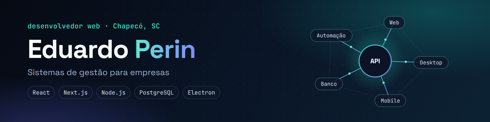

## Oi, sou o Eduardo

Moro em Chapecó (SC), faço Ciência da Computação na Unochapecó e trabalho como assistente técnico na Fluxo Equipamentos.

Antes disso passei uns bons anos na Aurora, primeiro como jovem aprendiz e depois como operador de produção. Entre a fábrica e a assistência técnica, vi muita coisa sendo controlada em planilha, papel e no "boca a boca". Hoje é isso que eu gosto de resolver: faço sistemas web para empresas pequenas e médias, quase sempre na parte de gestão (estoque, compras, ordens de serviço, cadastro de clientes).

### O projeto que mais me orgulho

**[Núcleo](https://github.com/AwsGames-byte/nucleo)** é um sistema de gestão que junta compras, estoque, almoxarifado, CRM e a parte de assistência técnica: agenda dos técnicos, ordens de serviço, equipamentos emprestados ou em locação. Roda no navegador, tem versão para desktop e um app Android. O código é privado, mas no repositório tem os detalhes de como ele funciona.

### O que eu uso no dia a dia

TypeScript, React e Next.js no front. Node com Express, Prisma e PostgreSQL no back. Electron quando o cliente quer um programa instalado no computador.

### Contato

Se tem algum processo na sua empresa que vive dando dor de cabeça, me chama no [LinkedIn](https://www.linkedin.com/in/eduardo-perin-95ba4a212/). Também curto trocar ideia com o pessoal de desenvolvimento e indústria aqui da região.
